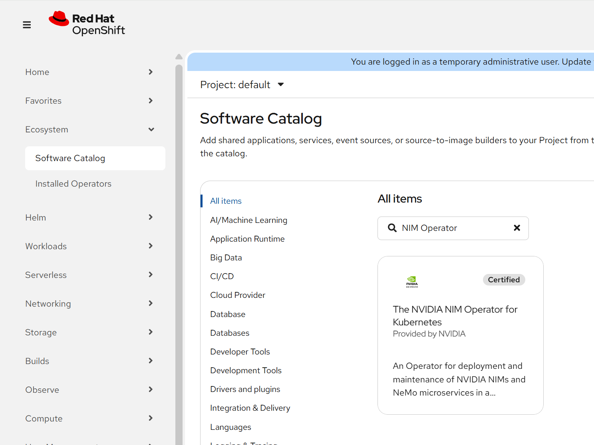

<Anchor id="installing-nvidia-nim-operator" />

This page outlines the prerequisites and installation instructions for the NVIDIA NIM Operator.

## Prerequisites

1. Available resources and GPU that meet the requirements for the NVIDIA NIM for LLM that you plan to deploy.
Refer to [Platform Support](/platform-support) for information on model resource requirements, supported operating systems, and Kubernetes platforms.

1. A Kubernetes cluster with any [platform-specific prerequisites](/platform-prerequisites) configured and the cluster-admin role.

1. An active subscription to an NVIDIA AI Enterprise product or be an
[NVIDIA Developer Program member](https://build.nvidia.com/explore/discover?integrate_nim=true&amp;developer_enroll=true&amp;self_hosted_api=true&amp;signin=true).
Access to the containers and models for NVIDIA NIM microservices is restricted.

1. NVIDIA GPU Operator installed.
The NVIDIA GPU Operator installs, configures, and manages the NVIDIA GPU driver and NVIDIA container runtime on the Kubernetes nodes.
The NIM Operator requires that the GPU Operator be installed on your cluster.
Default installation steps are listed below.
For more information or to adjust the configuration, refer to [Installing the NVIDIA GPU Operator](https://docs.nvidia.com/datacenter/cloud-native/gpu-operator/latest/https://docs.nvidia.com/datacenter/cloud-native/gpu-operator/latest/getting-started.html) in the NVIDIA GPU Operator documentation.

   1.    Add the Helm repository for NVIDIA:

      ```console
      $ helm repo add nvidia https://helm.ngc.nvidia.com/nvidia \
         && helm repo update
      ```

   1.    Install the GPU Operator:

      ```console
      $ helm install --wait --generate-name \
         -n gpu-operator --create-namespace \
         nvidia/gpu-operator
      ```

<Note>
If you are installing on Red Hat OpenShift, follow the steps in [Installing NIM Operator on Red Hat OpenShift Using the Web Console](#installing-nim-operator-on-red-hat-openshift-using-the-web-console).

If you are installing on any other Kubernetes platform or Cloud Service Provider managed Kubernetes, including TKG, EKS, AKS, OKE, and GKE, follow the steps in [Install the NIM Operator on Any Kubernetes Platform](#install-the-nim-operator-on-any-kubernetes-platform).

</Note>

## Install the NIM Operator on Any Kubernetes Platform

Use the following steps to install the NVIDIA NIM Operator on your Kubernetes cluster.

1. Add the Helm repository for NVIDIA:

   ```console
   $ helm repo add nvidia https://helm.ngc.nvidia.com/nvidia \
      && helm repo update
   ```

1. Create the Operator namespace:

   ```console
   $ kubectl create namespace nim-operator
   ```

1. Install the Operator:

   ```console
   $ helm upgrade --install nim-operator nvidia/k8s-nim-operator -n nim-operator --version=3.1.4
   ```

1. Optionally, confirm the controller pod is running:

   ```console
   $ kubectl get pods -n nim-operator
   ```

   *Example Output*

   ```output
   NAME                                            READY   STATUS    RESTARTS      AGE
   nim-operator-k8s-nim-operator-6b546f57d5-g4zgg  1/1     Running     0           35h
   ```

## Installing NIM Operator on Red Hat OpenShift Using the Web Console

1. In the OpenShift Container Platform web console from the side menu, navigate to **Ecosystem** > **Software Catalog**.
In OpenShift versions before 4.20, navigate to **Operators** > **OperatorHub**.

1. Search for the `nim-operator`.
For additional information refer to the [Red Hat OpenShift Container Platform documentation](https://docs.redhat.com/en/documentation/openshift_container_platform/4.18/html/operators/administrator-tasks#olm-installing-operators-from-operatorhub_olm-adding-operators-to-a-cluster).



1. Select the **NVIDIA NIM Operator for Kubernetes**, and click **Install** in the subsequent screen.
NVIDIA recommends that you install the latest version of the NIM Operator, but you can use the **Version** drop down and select a different NIM Operator version to install.

1. Verify the NIM Operator is installed, navigate to **Ecosystem** > **Installed Operators**.
In OpenShift versions before 4.20, navigate to **Operators** > **Installed Operators**.
The NVIDIA NIM Operator for Kubernetes should be listed.
Click on NVIDIA NIM Operator for Kubernetes to view details about the NIM Operator.

## Installing NIM Operator on Red Hat OpenShift Using operator-sdk (for Development-Only)

1. Create the Operator namespace:

   ```console
   $ oc create namespace nvidia-nim-operator
   ```

1. Add a Docker registry secret that the Operator uses for pulling containers and models from NGC:

   ```console
   $ oc create secret -n nvidia-nim-operator docker-registry ngc-secret \
       --docker-server=nvcr.io \
       --docker-username='$oauthtoken' \
       --docker-password=<ngc-api-key>
   ```

1. Install the Operator:

{/* operator-sdk run bundle ghcr.io/nvidia/k8s-nim-operator:bundle-latest-main --namespace nvidia-nim-operator --skip-tls --skip-tls-verify */}

   ```console
   $ operator-sdk run bundle ghcr.io/nvidia/k8s-nim-operator:bundle-latest-main --namespace nvidia-nim-operator
   ```

{/* FIXME: Determine final Helm repository. */}

1. Optional: Confirm the controller pod is running:

   ```console
   $ oc get pods -n nvidia-nim-operator
   ```

   *Example Output*

   ```output
   NAME                                                              READY   STATUS      RESTARTS   AGE
   ec60a4439c710b89fc2582f5384382b4241f9aee62bb3182b8d128e69d4jqfm   0/1     Completed   0          74m
   ghcr-io-nvidia-k8s-nim-operator-bundle-latest-main                1/1     Running     0          75m
   k8s-nim-operator-77bf775c88-bscjg                                 1/1     Running     0          74m
   ```

## Next Steps

- Create required [image pull secrets](/image-pull-secrets).

- Configure recommended [resource quotas](/resource-quotas) for NIM Operator namespaces.

- Refer to [Caching NIM Models](/cache) to download and cache inference and embedding models.
