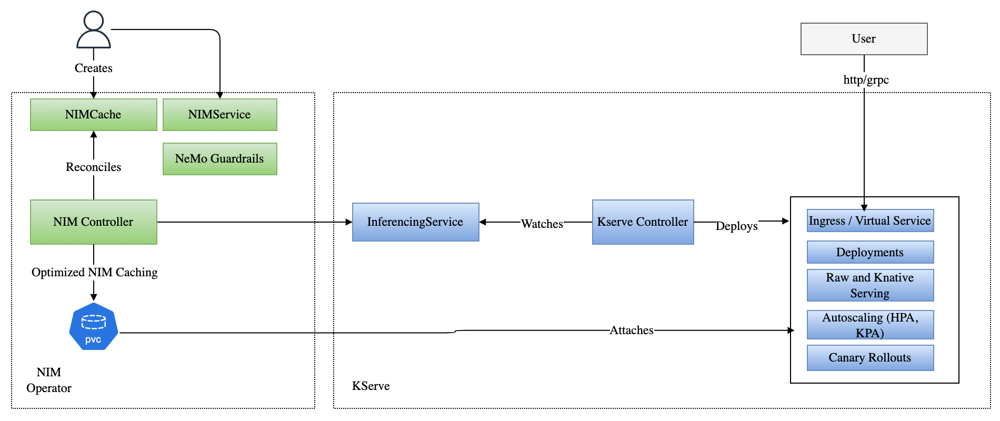
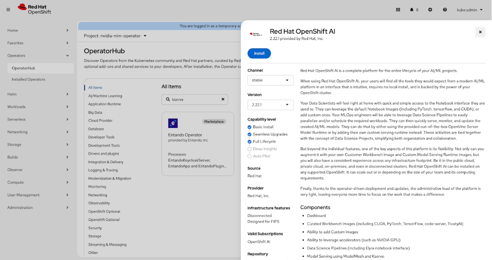
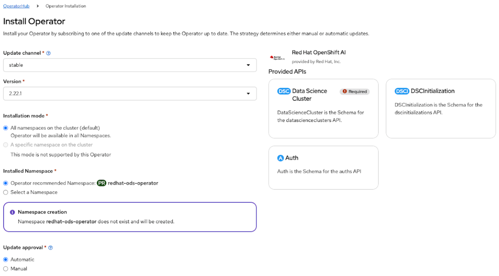
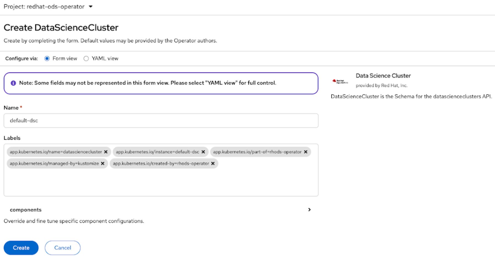
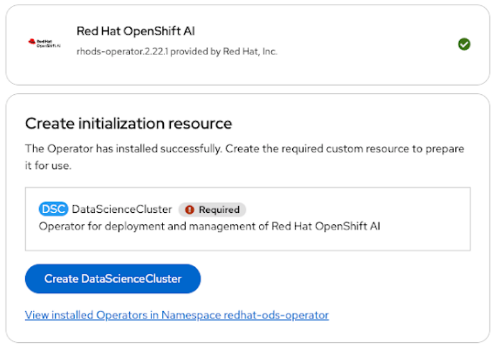

<Anchor id="kserve-support-on-nim-operator" />

## About KServe Support

The NIM Operator supports both raw deployment and serverless deployment
of NIM through [KServe](https://kserve.github.io/website/) on Kubernetes clusters,
including Red Hat OpenShift Container Platform.

NIM Operator with KServe provides two additional benefits:

1. Intelligent Caching with NIMCache to reduce initial inference time and autoscaling latency, resulting in faster and more responsive deployments.

1. NeMo Microservices support to evaluate, guardrail, and enhance AI systems across key metrics such as latency, accuracy, cost, and compliance.

The Operator configures KServe deployments using InferenceService to manage deployment, upgrade, ingress, and autoscaling of NIM.

<Card>


Diagram 1. NIM Operator and KServe interaction

</Card>

### KServe Deployment Modes Comparison

<table>
<thead>
<tr>
<th>

Category

</th>
<th>

KServe serverless (with Knative)

</th>
<th>

Raw Deployment

</th>
</tr>
</thead>
<tbody>
<tr>
<td>

Autoscaling

</td>
<td>

Scales pods automatically based on request load (speed and traffic).
Can scale all the way to zero when unused.

These are configured by providing Knative [annotations](https://knative.dev/docs/serving/autoscaling/)
in the NIMService `spec.annotations` field.

</td>
<td>

Uses Horizontal/Vertical Pod Autoscalers with custom NIM metrics.
Cannot scale to zero by default.

These are configured by providing `spec.scaling.hpa` config in the NIM service.

</td>
</tr>
<tr>
<td>

Upgrades

</td>
<td>

Every new model version creates a new revision.
Can send only a portion of traffic to test new versions.
Easy rollback by shifting traffic.

This is automatically managed by KServe.
No special parameters required in the NIMService API.
Refer to the Knative documentation on [gradual rollouts](https://knative.dev/docs/serving/rolling-out-latest-revision/)
and [traffic management](https://knative.dev/docs/serving/traffic-management/) for configuring canary rollouts.

</td>
<td>

Uses rolling updates.
Rollback is manual if something goes wrong.

This is not configurable. Only *RollingUpdate* of native Kubernetes deployment is supported.

</td>
</tr>
<tr>
<td>

Ingress

</td>
<td>

Uses Knative Gateway (such as Istio).
Gives each model revision a stable domain/URL.
Built-in secure connections.
Has a queue system to handle overload.

This is automatically managed by KServe.
No special parameters are added.
The domain name has to be configured during KServe install (default example.com).

</td>
<td>

Exposed using Kubernetes Service + Ingress/LoadBalancer (NGINX, Istio, etc.)
Security (mTLS, certificates) must be set up manually.

This is automatically managed by KServe.
No special parameters are added.
The domain name has to be configured during KServe install (default example.com).

</td>
</tr>
<tr>
<td>

NIM Metrics

</td>
<td>

Metrics and tracing are built in through Knative, KServe, and service mesh.

No extra config in the NIMService is required.

</td>
<td>

Must build your own stack. For example, Prometheus, Grafana, OpenTelemetry, etc.

ServiceMonitor needs to be enabled through the NIMService `spec.metrics.enabled`
field set to `true` and `spec.metrics.serviceMonitor` config.

</td>
</tr>
<tr>
<td>

GPU Resources

</td>
<td>

Passed using the `spec.resources` field.

</td>
<td>

Passed using the `spec.resources` field.

</td>
</tr>
<tr>
<td>

Multi-Node

</td>
<td>

Not supported.

</td>
<td>

Not supported.

</td>
</tr>
<tr>
<td>

Dynamic Resource Allocation (DRA)

</td>
<td>

Not supported.

</td>
<td>

Not supported.

</td>
</tr>
<tr>
<td>

Tolerations

</td>
<td>

Passed through `spec.tolerations` in NIMService.

Feature gates must be enabled with the Knative
[config](https://knative.dev/docs/serving/configuration/feature-flags/).

</td>
<td>

Passed through `spec.tolerations` in NIMService.

</td>
</tr>
<tr>
<td>

RuntimeClassName

</td>
<td>

Passed through `spec.runtimeClassName` in NIMService.

Feature gates must be enabled with the Knative
[config](https://knative.dev/docs/serving/configuration/feature-flags/).

</td>
<td>

Passed through `spec.runtimeClassName` in NIMService.

</td>
</tr>
<tr>
<td>

NodeSelectors

</td>
<td>

Passed through `spec.nodeSelectors` in NIMService.

Feature gates must be enabled with the Knative
[config](https://knative.dev/docs/serving/configuration/feature-flags/).

</td>
<td>

Passed through `spec.nodeSelectors` in NIMService.

</td>
</tr>
<tr>
<td>

Custom Scheduler Name

</td>
<td>

Passed through `spec.schedulerName` in NIMService.

Feature gates must be enabled with the Knative
[config](https://knative.dev/docs/serving/configuration/feature-flags/).

</td>
<td>

Passed through `spec.schedulerName` in NIMService.

</td>
</tr>
<tr>
<td>

Pod Priority

</td>
<td>

Passed through `spec.priorityClassName` in a `NIMService`.

Enable the Knative `kubernetes.podspec-priorityclassname` feature flag.
Refer to the Knative documentation for [Kubernetes Priority Class Name](https://knative.dev/docs/serving/configuration/feature-flags/#kubernetes-priority-class-name).

</td>
<td>

Passed through `spec.priorityClassName` in a `NIMService` without requiring a Knative feature flag.

</td>
</tr>
</tbody>
</table>

### Select Your Deployment Environment and Type

<CardGroup cols={2}>
<Card href="#raw-deployment-example-on-standard-kubernetes">
**Raw Deployment<br />
on Standard Kubernetes**

</Card>

<Card href="#raw-deployment-example-on-red-hat-openshift">
**Raw Deployment<br />
on Red Hat OpenShift**

</Card>

<Card href="#serverless-deployment-example-on-standard-kubernetes">
**Serverless Deployment<br />
on Standard Kubernetes**

</Card>

</CardGroup>

<Note>
This documentation uses `kubectl` for Kubernetes examples and `oc` for OpenShift examples. Both tools provide similar functionality for their respective platforms.

</Note>

## Raw Deployment Example on Standard Kubernetes

### Summary

For raw deployment of NIM through KServe on a standard Kubernetes installation, follow these steps:

1. [Install KServe](#install-kserve-in-raw-deployment-mode).

1. Optional: [Create NIM Cache](#optional-create-nim-cache).

1. [Deploy NIM through KServe](#deploy-nim-through-kserve-as-a-raw-deployment).

<Anchor id="install-kserve-in-raw-deployment-mode" />

### 1. Install KServe in Raw Deployment Mode

<Note>
For security, consider downloading and reviewing the script before execution in production environments.

</Note>

Run the following command to execute the KServe quick install script:

```console
$ curl -s "https://raw.githubusercontent.com/kserve/kserve/release-0.16/hack/quick_install.sh" | bash -s - -r
```

For more information, refer to [Getting Started with KServe](https://kserve.github.io/website/docs/getting-started/quickstart-guide).

The following components are deployed by the KServe quick install script:

<table>
<thead>
<tr>
<th>

Component

</th>
<th>

Description

</th>
</tr>
</thead>
<tbody>
<tr>
<td>

KServe

</td>
<td>

- Installs KServe CRDs, such as `InferenceService`.

- Installs KServe controller in the `kserve` namespace.

- Provides model serving, autoscaling, and inference management on Kubernetes.

</td>
</tr>
<tr>
<td>

Gateway API CRDs

</td>
<td>

- Installs the Gateway API CustomResourceDefinitions: `GatewayClass`, `Gateway`, `GRPCRoute`, `HTTPRoute`, `ReferenceGrant`.

- Provides modern networking primitives for routing traffic into services.

</td>
</tr>
<tr>
<td>

Istio (Service Mesh)

</td>
<td>

Deployed into the `istio-system` namespace with Helm charts:

- `istio-base`: core Istio CRDs and cluster-scoped resources.

- `istiod`: Istio control plane (pilot, configuration, service discovery).

- `istio-ingressgateway`: data plane ingress gateway for external traffic.

</td>
</tr>
<tr>
<td>

Cert-Manager

</td>
<td>

- Installed in the `cert-manager` namespace.

- Handles TLS certificate provisioning and management.

- Required for automatic HTTPS and secure communication.

</td>
</tr>
</tbody>
</table>

Verify the installation by checking each component:

1. KServe

   ```console
   $ kubectl get pods -n kserve
   ```

   <Accordion title="Example output">
   ```output
   NAME                                         READY   STATUS    RESTARTS   AGE
   kserve-controller-manager-85768d7b78-lrmss   2/2     Running   0          2m56s
   ```

   </Accordion>

1. Istio System

   ```console
   $ kubectl get pods -n istio-system
   ```

   <Accordion title="Example output">
   ```output
   NAME                                    READY   STATUS    RESTARTS   AGE
   istio-ingressgateway-74949b4866-hk5nf   1/1     Running   0          3m50s
   istiod-77bbc7c8bb-qkwdt                 1/1     Running   0          4m1s
   ```

   </Accordion>

1. Cert Manager

   ```console
   $ kubectl get pods -n cert-manager
   ```

   <Accordion title="Example output">
   ```output
   NAME                                       READY   STATUS    RESTARTS   AGE
   cert-manager-74b7f6cbbc-7mrrw              1/1     Running   0          4m18s
   cert-manager-cainjector-58c9d76cb8-t8bxb   1/1     Running   0          4m18s
   cert-manager-webhook-5875b545cf-dhhfb      1/1     Running   0          4m18s
   ```

   </Accordion>

<Note>
To uninstall KServe, follow the instructions in [Uninstalling KServe](#uninstalling-kserve).

</Note>

<Anchor id="optional-create-nim-cache" />

### 2. Optional: Create NIM Cache

<Note>
Refer to [prerequisites](/cache#prerequisites) for more information on using NIM Cache.

</Note>

<Tabs>
  <Tab title="For an LLM-Specific NIM" language="llm-specific">

1. Create a file, such as `nimcache.yaml`, with contents like the following [sample manifest](https://github.com/NVIDIA/k8s-nim-operator/blob/release-3.0/config/samples/nim/serving/kserve/standard/llm.yaml):

   <Code src="../../manifests/docs/current/input/nim/serving/kserve/standard/llm.yaml" language="yaml" startLine="1" lines="3-23" />

1. Apply the manifest:

   ```console
   $ kubectl apply -n nim-service -f nimcache.yaml
   ```

  </Tab>
  <Tab title="For a Multi-LLM NIM" language="multi-llm">

1. Create a file, such as `nimcache.yaml`, with contents like the following [sample manifest](https://github.com/NVIDIA/k8s-nim-operator/blob/release-3.0/config/samples/nim/serving/kserve/standard/multi-llm.yaml):

   <Code src="../../manifests/docs/current/input/nim/serving/kserve/standard/multi-llm.yaml" language="yaml" startLine="1" lines="3-23" />

1. Apply the manifest:

   ```console
   $ kubectl apply -n nim-service -f nimcache.yaml
   ```

  </Tab>

</Tabs>

<Anchor id="deploy-nim-through-kserve-as-a-raw-deployment" />

### 3. Deploy NIM through KServe as a Raw Deployment

<Tabs>
  <Tab title="For an LLM-Specific NIM" language="llm-specific">

1. Create a file, such as `nimservice.yaml`, with contents like the following [sample manifest](https://github.com/NVIDIA/k8s-nim-operator/blob/release-3.0/config/samples/nim/serving/kserve/standard/llm.yaml):

   <Code src="../../manifests/docs/current/input/nim/serving/kserve/standard/llm.yaml" language="yaml" startLine="1" lines="26-72" />

1. Apply the manifest for raw deployment:

   ```console
   $ kubectl create -f nimservice.yaml -n nim-service
   ```

1. Verify that the inference service has been created:

   1.    View inference service details:

      ```console
      $ kubectl get inferenceservice -n nim-service -o yaml
      ```

      <Accordion title="Example output">
      ```output
        apiVersion: v1
        items:
        - apiVersion: serving.kserve.io/v1beta1
          kind: InferenceService
          metadata:
            annotations:
              nvidia.com/last-applied-hash: 757475558b
              nvidia.com/parent-spec-hash: b978f49f7
              openshift.io/required-scc: nonroot
              serving.kserve.io/autoscalerClass: hpa
              serving.kserve.io/deploymentMode: RawDeployment
              serving.kserve.io/enable-metric-aggregation: "true"
              serving.kserve.io/enable-prometheus-scraping: "true"
              temp: temp-1
            creationTimestamp: "2025-07-25T14:58:06Z"
            finalizers:
            - inferenceservice.finalizers
            generation: 1
            labels:
              app.kubernetes.io/instance: meta-llama-3-2-1b-instruct
              app.kubernetes.io/managed-by: k8s-nim-operator
              app.kubernetes.io/name: meta-llama-3-2-1b-instruct
              app.kubernetes.io/operator-version: ""
              app.kubernetes.io/part-of: nim-service
              networking.kserve.io/visibility: cluster-local
              temp2: temp-2
            name: meta-llama-3-2-1b-instruct
            namespace: nim-service
            ownerReferences:
            - apiVersion: apps.nvidia.com/v1alpha1
              blockOwnerDeletion: true
              controller: true
              kind: NIMService
              name: meta-llama-3-2-1b-instruct
              uid: aaa7e95a-81e4-404a-a1de-6dce898f9937
            resourceVersion: "43983337"
            uid: c92a7aa9-4954-4959-86b3-ad8aa6c39ca8
          spec:
            predictor:
              annotations:
                openshift.io/required-scc: nonroot
                serving.kserve.io/deploymentMode: RawDeployment
                temp: temp-1
              containers:
              - env:
                - name: MY_ENV
                  value: my-value
                - name: NIM_CACHE_PATH
                  value: /model-store
                - name: NGC_API_KEY
                  valueFrom:
                    secretKeyRef:
                      key: NGC_API_KEY
                      name: ngc-api-secret
                - name: OUTLINES_CACHE_DIR
                  value: /tmp/outlines
                - name: NIM_SERVER_PORT
                  value: "8000"
                - name: NIM_HTTP_API_PORT
                  value: "8000"
                - name: NIM_JSONL_LOGGING
                  value: "1"
                - name: NIM_LOG_LEVEL
                  value: INFO
                image: nvcr.io/nim/meta/llama-3.2-1b-instruct:1.8
                imagePullPolicy: IfNotPresent
                livenessProbe:
                  failureThreshold: 3
                  httpGet:
                    path: /v1/health/live
                    port: api
                  initialDelaySeconds: 15
                  periodSeconds: 10
                  successThreshold: 1
                  timeoutSeconds: 1
                name: kserve-container
                ports:
                - containerPort: 8000
                  name: api
                  protocol: TCP
                readinessProbe:
                  failureThreshold: 3
                  httpGet:
                    path: /v1/health/ready
                    port: api
                  initialDelaySeconds: 15
                  periodSeconds: 10
                  successThreshold: 1
                  timeoutSeconds: 1
                resources:
                  limits:
                    cpu: "12"
                    memory: 32Gi
                    nvidia.com/gpu: "1"
                  requests:
                    cpu: "12"
                    memory: 32Gi
                    nvidia.com/gpu: "1"
                startupProbe:
                  failureThreshold: 30
                  httpGet:
                    path: /v1/health/ready
                    port: api
                  initialDelaySeconds: 30
                  periodSeconds: 10
                  successThreshold: 1
                  timeoutSeconds: 1
                volumeMounts:
                - mountPath: /model-store
                  name: model-store
                - mountPath: /dev/shm
                  name: dshm
              deploymentStrategy:
                rollingUpdate:
                  maxSurge: 0
                  maxUnavailable: 25%
                type: RollingUpdate
              imagePullSecrets:
              - name: ngc-secret
              labels:
                app: meta-llama-3-2-1b-instruct
              maxReplicas: 3
              minReplicas: 1
              scaleMetric: cpu
              scaleMetricType: Utilization
              scaleTarget: 80
              securityContext:
                fsGroup: 2500
                runAsGroup: 2500
                runAsUser: 2500
              serviceAccountName: meta-llama-3-2-1b-instruct
              volumes:
              - emptyDir:
                  medium: Memory
                name: dshm
              - name: model-store
                persistentVolumeClaim:
                  claimName: meta-llama-3-2-1b-instruct-pvc
          status:
            address:
              url: http://meta-llama-3-2-1b-instruct-predictor.nim-service.svc.cluster.local
            components:
              predictor:
                url: http://meta-llama-3-2-1b-instruct-predictor-nim-service.example.com
            conditions:
            - lastTransitionTime: "2025-07-25T14:58:06Z"
              status: "True"
              type: IngressReady
            - lastTransitionTime: "2025-07-25T14:58:06Z"
              status: "True"
              type: PredictorReady
            - lastTransitionTime: "2025-07-25T14:58:06Z"
              status: "True"
              type: Ready
            deploymentMode: RawDeployment
            modelStatus:
              copies:
                failedCopies: 0
                totalCopies: 1
              states:
                activeModelState: Loaded
                targetModelState: Loaded
              transitionStatus: UpToDate
            observedGeneration: 1
            url: http://meta-llama-3-2-1b-instruct-nim-service.example.com
        kind: List
        metadata:
          resourceVersion: ""
      ```

      </Accordion>

   1.    View inference service status:

      ```console
      $ kubectl get inferenceservice -n nim-service
      ```

      <Accordion title="Example output">
      ```output
      NAME                         URL                                                          READY   AGE
      meta-llama-3-2-1b-instruct   http://meta-llama-3-2-1b-instruct-nim-service.example.com    True    100s
      ```

      </Accordion>

   1.    View NIM Service status:

      ```console
      $ kubectl get nimservice -n nim-service -o json | jq .items[0].status
      ```

      <Accordion title="Example output">
      ```output
      {
        "conditions": [
          {
            "lastTransitionTime": "2025-07-25T15:02:09Z",
            "message": "",
            "reason": "Ready",
            "status": "True",
            "type": "Ready"
          },
          {
            "lastTransitionTime": "2025-07-25T14:58:06Z",
            "message": "",
            "reason": "Ready",
            "status": "False",
            "type": "Failed"
          }
        ],
        "model": {
          "clusterEndpoint": "http://meta-llama-3-2-1b-instruct-predictor.nim-service.svc.cluster.local",
          "externalEndpoint": "http://meta-llama-3-2-1b-instruct-nim-service.example.com",
          "name": "meta/llama-3.2-1b-instruct"
        },
        "state": "Ready"
      }
      ```

      </Accordion>

1. Verify that the HPA has been created:

   ```console
   $ kubectl get hpa -n nim-service meta-llama-3-2-1b-instruct-predictor -o yaml
   ```

  </Tab>
  <Tab title="For a Multi-LLM NIM" language="multi-llm">

1. Create a file, such as `nimservice.yaml`, with contents like the following [sample manifest](https://github.com/NVIDIA/k8s-nim-operator/blob/release-3.0/config/samples/nim/serving/kserve/standard/multi-llm.yaml):

   <Code src="../../manifests/docs/current/input/nim/serving/kserve/standard/multi-llm.yaml" language="yaml" startLine="1" lines="26-61" />

1. Apply the manifest for raw deployment:

   ```console
   $ kubectl create -f nimservice.yaml -n nim-service
   ```

1. Verify that the inference service has been created:

   ```console
   $ kubectl get inferenceservice -n nim-service nim-service-multi-llm -o yaml
   ```

  </Tab>

</Tabs>

## Raw Deployment Example on Red Hat OpenShift

<Anchor id="id1" />

### Summary

For raw deployment of NIM through KServe using Red Hat OpenShift, follow these steps:

1. [Install KServe using OpenShift interface](#install-kserve-in-raw-deployment-mode-using-openshift).

1. [Create NIM Cache using OpenShift](#create-nim-cache-using-openshift).

1. [Deploy NIM through KServe using OpenShift](#deploy-nim-through-kserve-as-a-raw-deployment-using-openshift).

<Anchor id="install-kserve-in-raw-deployment-mode-using-openshift" />

### 1. Install KServe in Raw Deployment Mode Using OpenShift

1. Follow the instructions on the Red Hat website for [installing the single-model serving platform](https://docs.redhat.com/en/documentation/red_hat_openshift_ai_cloud_service/1/html/installing_and_uninstalling_openshift_ai_cloud_service/installing-the-single-model-serving-platform_component-install#configuring-automated-installation-of-kserve_component-install) to install the OpenShift AI Operator.

<Card>


   Figure 1. OpenShift web console

</Card>

<Card>


   Figure 2. Interface to install OpenShift AI Operator

</Card>

   Follow the steps for `standard` deployment (OpenShift’s term for raw deployment mode).
Select the following settings:

   -    **Update channel**: stable

   -    **Version**: 2.22.1

   -    **Operator recommended namespace**: redhat-ods-operator

   <Note>
   There is also an `advanced` mode, which is equivalent to serverless; however, the NIM Operator does not support it in this release.

   </Note>

1. Create an instance of Data Science Cluster (DSC)

<Card>


   Figure 3. Interface to create instance of DSC

</Card>

   Use the following YAML to create the DSC:

   ```yaml
   kind: DataScienceCluster
   metadata:
     labels:
       app.kubernetes.io/created-by: rhods-operator
       app.kubernetes.io/instance: default-dsc
       app.kubernetes.io/managed-by: kustomize
       app.kubernetes.io/name: datasciencecluster
       app.kubernetes.io/part-of: rhods-operator
     name: default-dsc
   spec:
     components:
       codeflare:
         managementState: Managed
       kserve:
         defaultDeploymentMode: RawDeployment
         managementState: Managed
         nim:
           managementState: Managed
         rawDeploymentServiceConfig: Headed
         serving:
           ingressGateway:
             certificate:
               type: OpenshiftDefaultIngress
           managementState: Removed
           name: knative-serving
       modelregistry:
         registriesNamespace: rhoai-model-registries
       feastoperator: {}
       trustyai: {}
       ray: {}
       kueue: {}
       workbenches:
         workbenchNamespace: rhods-notebooks
       dashboard: {}
       modelmeshserving: {}
       llamastackoperator: {}
       datasciencepipelines: {}
       trainingoperator: {}
   ```

1. Create an instance of DSCInitialization (DSI):

<Card>


   Figure 4. Interface to create instance of DSI

</Card>

   Use the following YAML to create the DSI:

   ```yaml
   apiVersion: dscinitialization.opendatahub.io/v1
   kind: DSCInitialization
   metadata:
     name: default-dsci
   spec:
     applicationsNamespace: redhat-ods-applications
     serviceMesh:
       controlPlane:
         metricsCollection: Istio
         name: data-science-smcp
         namespace: istio-system
       managementState: Removed
   ```

1. Verify the KServe controller is running:

   Click on **Workloads** > **Pods** > ***redhat-ods-applications* project**.

<Anchor id="create-nim-cache-using-openshift" />

### 2. Create NIM Cache Using OpenShift

<Note>
Refer to [prerequisites](/cache#prerequisites) for more information on using NIM Cache.

</Note>

1. Create a file, such as `nimcache.yaml`, with contents like the following example:

   <Code src="../../manifests/docs/current/input/kserve-all.yaml" language="yaml" startLine="1" lines="57-76" />

1. Apply the manifest:

   ```console
   $ oc apply -n nim-service -f nimcache.yaml
   ```

<Anchor id="deploy-nim-through-kserve-as-a-raw-deployment-using-openshift" />

### 3. Deploy NIM Through KServe as a Raw Deployment Using OpenShift

1. Create a file, such as `nimservice.yaml`, with contents like the following example:

   <Code src="../../manifests/docs/current/input/kserve-all.yaml" language="yaml" startLine="1" lines="78-123" />

1. Apply the manifest for raw deployment:

   ```console
   $ oc create -f nimservice.yaml -n nim-service
   ```

1. Verify that the inference service has been created:

   1.    View inference service details:

      ```console
      $ oc get inferenceservice -n nim-service -o json | jq .items[0].status
      ```

      <Accordion title="Example output">
      ```output
      {
        "address": {
          "url": "http://meta-llama-3-2-1b-instruct-predictor.nim-service.svc.cluster.local"
        },
        "components": {
          "predictor": {}
        },
        "conditions": [
          {
            "lastTransitionTime": "2025-08-15T05:59:00Z",
            "status": "True",
            "type": "IngressReady"
          },
          {
            "lastTransitionTime": "2025-08-15T05:59:00Z",
            "status": "True",
            "type": "PredictorReady"
          },
          {
            "lastTransitionTime": "2025-08-15T05:59:00Z",
            "status": "True",
            "type": "Ready"
          },
          {
            "lastTransitionTime": "2025-08-15T05:58:59Z",
            "severity": "Info",
            "status": "False",
            "type": "Stopped"
          }
        ],
        "deploymentMode": "RawDeployment",
        "modelStatus": {
          "copies": {
            "failedCopies": 0,
            "totalCopies": 1
          },
          "states": {
            "activeModelState": "Loaded",
            "targetModelState": "Loaded"
          },
          "transitionStatus": "UpToDate"
        },
        "observedGeneration": 1,
        "url": "http://meta-llama-3-2-1b-instruct-predictor.nim-service.svc.cluster.local"
      }
      ```

      </Accordion>

   1.    View NIM Service status:

      ```console
      $ oc get nimservice -n nim-service meta-llama-3-2-1b-instruct  -o json | jq .status
      ```

      <Accordion title="Example output">
      ```output
      {
        "conditions": [
          {
            "lastTransitionTime": "2025-08-15T05:59:50Z",
            "message": "",
            "reason": "Ready",
            "status": "True",
            "type": "Ready"
          },
          {
            "lastTransitionTime": "2025-08-15T05:58:59Z",
            "message": "",
            "reason": "Ready",
            "status": "False",
            "type": "Failed"
          }
        ],
        "model": {
          "clusterEndpoint": "http://meta-llama-3-2-1b-instruct-predictor.nim-service.svc.cluster.local",
          "externalEndpoint": "http://meta-llama-3-2-1b-instruct-predictor.nim-service.svc.cluster.local",
          "name": "meta/llama-3.2-1b-instruct"
        },
        "state": "Ready"
      }
      ```

      </Accordion>

1. Run inference:

   ```console
   $ oc -n nim-service run curltest --rm -i --image=curlimages/curl --restart=Never -- \
     curl -s http://meta-llama-3-2-1b-instruct-predictor.nim-service.svc.cluster.local/v1/chat/completions \
     -H 'Content-Type: application/json' \
     -d '{"model":"meta/llama-3.2-1b-instruct","messages":[{"role":"user","content":"Hello!"}]}'
   ```

   <Accordion title="Example output">
   ```output
   {"id":"chat-2d3c821536514598b931783033a7e7e7","object":"chat.completion","created":1755239534,"model":"meta/llama-3.2-1b-instruct","choices":[{"index":0,"message":{"role":"assistant","content":"Hello! How can I help you today?"},"logprobs":null,"finish_reason":"stop","stop_reason":null}],"usage":{"prompt_tokens":12,"total_tokens":21,"completion_tokens":9},"prompt_logprobs":null}
   ```

   </Accordion>

## Serverless Deployment Example on Standard Kubernetes

<Anchor id="id2" />

### Summary

For serverless deployment of NIM through KServe on a standard Kubernetes installation, follow these steps:

1. [Install KServe in Serverless Mode](#install-kserve-in-serverless-mode).

1. [Enable PVC support](#enable-pvc-support).

1. Optional: [Create NIM Cache with Serverless Deployment](#optional-create-nim-cache-with-serverless-deployment).

1. [Deploy NIM through KServe as a Serverless Deployment](#deploy-nim-through-kserve-as-a-serverless-deployment).

<Anchor id="install-kserve-in-serverless-mode" />

### 1. Install KServe in Serverless Mode

<Note>
For security, consider downloading and reviewing the script before execution in production environments.

</Note>

Run the following command to execute the KServe quick install script:

```console
$ curl -s "https://raw.githubusercontent.com/kserve/kserve/release-0.16/hack/quick_install.sh" | bash
```

For more information, refer to [Getting Started with KServe](https://kserve.github.io/website/docs/getting-started/quickstart-guide).

The following components are deployed by the KServe quick install script:

<table>
<thead>
<tr>
<th>

Component

</th>
<th>

Description

</th>
</tr>
</thead>
<tbody>
<tr>
<td>

KServe

</td>
<td>

- Installs KServe CRDs, such as `InferenceService`.

- Installs KServe controller in the `kserve` namespace.

- Provides model serving, autoscaling, and inference management on Kubernetes.

</td>
</tr>
<tr>
<td>

Gateway API CRDs

</td>
<td>

- Installs the Gateway API CustomResourceDefinitions: `GatewayClass`, `Gateway`, `GRPCRoute`, `HTTPRoute`, `ReferenceGrant`.

- Provides modern networking primitives for routing traffic into services.

</td>
</tr>
<tr>
<td>

Istio (Service Mesh)

</td>
<td>

Deployed into the `istio-system` namespace with Helm charts:

- `istio-base`: core Istio CRDs and cluster-scoped resources.

- `istiod`: Istio control plane (pilot, configuration, service discovery).

- `istio-ingressgateway`: data plane ingress gateway for external traffic.

</td>
</tr>
<tr>
<td>

Cert-Manager

</td>
<td>

- Installed in the `cert-manager` namespace.

- Handles TLS certificate provisioning and management.

- Required for automatic HTTPS and secure communication.

</td>
</tr>
<tr>
<td>

Knative

</td>
<td>

- Installs the Knative Operator in knative-serving namespace.

- Deploys a KnativeServing custom resource.

- Provides serverless deployment and scaling primitives used by KServe.

</td>
</tr>
</tbody>
</table>

<Note>
To uninstall KServe, follow the instructions in [Uninstalling KServe](#uninstalling-kserve).

</Note>

<Anchor id="enable-pvc-support" />

### 2. Enable PVC Support

Run the following command to enable persistent volume support:

```console
$ kubectl patch --namespace knative-serving configmap/config-features \
  --type merge \
  --patch '{"data":{"kubernetes.podspec-persistent-volume-claim": "enabled", "kubernetes.podspec-persistent-volume-write": "enabled"}}'
```

These extensions enable persistent volume support:

- `kubernetes.podspec-persistent-volume-claim`: Enables persistent volumes (PVs) with Knative Serving

- `kubernetes.podspec-persistent-volume-write`: Provides write access to those PVs

<Anchor id="optional-create-nim-cache-with-serverless-deployment" />

### 3. Optional: Create NIM Cache With Serverless Deployment

<Note>
Refer to [prerequisites](/cache#prerequisites) for more information on using NIM Cache.

</Note>

1. Create a file, such as `nimcache.yaml`, with contents like the following [sample manifest](https://github.com/NVIDIA/k8s-nim-operator/blob/release-3.0/config/samples/nim/serving/kserve/knative/llm.yaml):

   <Code src="../../manifests/docs/current/input/nim/serving/kserve/knative/llm.yaml" language="yaml" startLine="1" lines="3-24" />

1. Apply the manifest:

   ```console
   $ kubectl apply -n nim-service -f nimcache.yaml
   ```

<Anchor id="deploy-nim-through-kserve-as-a-serverless-deployment" />

### 4. Deploy NIM through KServe as a Serverless Deployment

<Note>
Autoscaling and ingress are handled directly by KServe, not through NIMService configuration.

</Note>

1. Create a file, such as `nimservice.yaml`, with contents like the following [sample manifest](https://github.com/NVIDIA/k8s-nim-operator/blob/release-3.0/config/samples/nim/serving/kserve/knative/llm.yaml):

   <Code src="../../manifests/docs/current/input/nim/serving/kserve/knative/llm.yaml" language="yaml" startLine="1" lines="27-68" />

1. Apply the manifest for serverless deployment:

   ```console
   $ kubectl create -f nimservice.yaml -n nim-service
   ```

1. Verify that the inference service has been created:

   ```console
   $ kubectl get inferenceservice -n nim-service meta-llama-3-2-1b-instruct-serverless -o yaml
   ```

## Uninstalling KServe

If you installed KServe using the `https://raw.githubusercontent.com/kserve/kserve/release-0.16/hack/quick_install.sh` quick install script, use the following commands to uninstall it:

```bash
helm uninstall --ignore-not-found istio-ingressgateway -n istio-system
helm uninstall --ignore-not-found istiod -n istio-system
helm uninstall --ignore-not-found istio-base -n istio-system
echo "😀 Successfully uninstalled Istio"

helm uninstall --ignore-not-found cert-manager -n cert-manager
echo "😀 Successfully uninstalled Cert Manager"

helm uninstall --ignore-not-found keda -n keda
echo "😀 Successfully uninstalled KEDA"

kubectl delete --ignore-not-found=true KnativeServing knative-serving -n knative-serving --wait=True --timeout=300s || true
helm uninstall --ignore-not-found knative-operator -n knative-serving
echo "😀 Successfully uninstalled Knative"

helm uninstall --ignore-not-found kserve -n kserve
helm uninstall --ignore-not-found kserve-crd -n kserve
echo "😀 Successfully uninstalled KServe"

kubectl delete --ignore-not-found=true namespace istio-system
kubectl delete --ignore-not-found=true namespace cert-manager
kubectl delete --ignore-not-found=true namespace kserve
```
